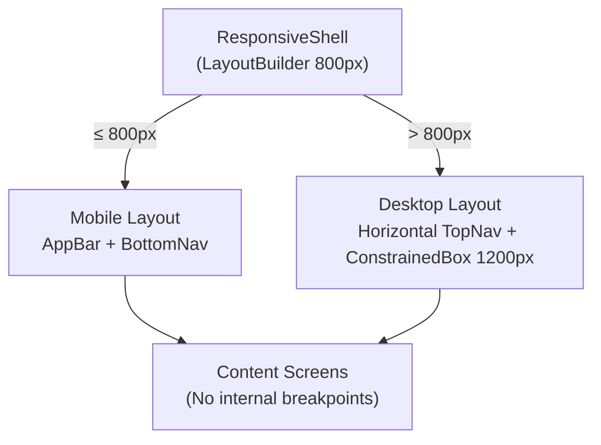
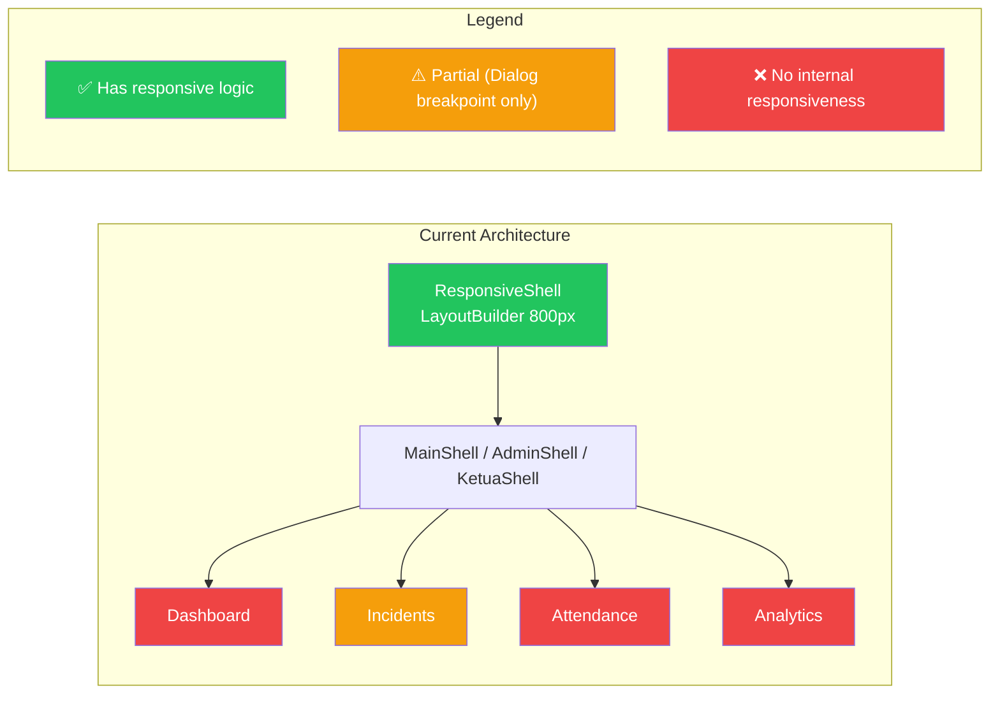

# SRS Patrol App — UI Layout Analysis

> Analysed against [Flutter Adaptive & Responsive Best Practices](https://docs.flutter.dev/ui/adaptive-responsive/best-practices)

---

## Executive Summary

The SRS Patrol App uses a **Mobile-First design with basic Web/Desktop adaptation**. It is **NOT a fully responsive or adaptive app** — it follows a **two-tier responsive pattern** with a single primary breakpoint at `800px` managed by a centralized `ResponsiveShell` widget. Individual content screens do not adapt their internal layouts for different screen sizes.



---

## 1. Current Layout Classification

Per Flutter's responsive layout taxonomy, the app's approach maps to:

| Flutter Layout Type | Used? | Where |
|---|:---:|---|
| **Fixed Layout** (hardcoded sizes) | ✅ Heavily | Most content screens — charts, cards, dialogs |
| **Responsive Layout** (adapts to available space) | ✅ Partially | Shell navigation only (800px breakpoint) |
| **Adaptive Layout** (different UI for different form factors) | ✅ Minimal | Auth screens (Login/Register), detail view Dialogs |
| **Fluid Layout** (proportional sizing) | ❌ Rare | Only 1 instance: `MediaQuery.size.width * 0.70` in [attendance_screen.dart](file:///c:/Users/rafee/Documents/UTeM/FYP/srs_app/lib/features/attendance/views/attendance_screen.dart) |

---

## 2. Breakpoints Used

The app defines only **2 breakpoints**, compared to Flutter's recommended 3-tier system:

| Breakpoint | Widget | Files | Purpose |
|---|---|---|---|
| **800px** | `LayoutBuilder` | [responsive_shell.dart](file:///c:/Users/rafee/Documents/UTeM/FYP/srs_app/lib/core/widgets/responsive_shell.dart), [login_screen.dart](file:///c:/Users/rafee/Documents/UTeM/FYP/srs_app/lib/features/auth/views/login_screen.dart), [register_screen.dart](file:///c:/Users/rafee/Documents/UTeM/FYP/srs_app/lib/features/auth/views/register_screen.dart) | Mobile ↔ Desktop shell switch |
| **600px** | `MediaQuery.of(context).size.width` | [incident_screen.dart](file:///c:/Users/rafee/Documents/UTeM/FYP/srs_app/lib/features/incident/views/incident_screen.dart), [incident_detail_screen.dart](file:///c:/Users/rafee/Documents/UTeM/FYP/srs_app/lib/features/incident/views/incident_detail_screen.dart), [admin_incident_screen.dart](file:///c:/Users/rafee/Documents/UTeM/FYP/srs_app/lib/features/post/views/admin_incident_screen.dart) | Dialog vs. Navigator.push for detail views |

> [!IMPORTANT]
> **Flutter recommends 3 breakpoints:**
> - Mobile: < 600px
> - Tablet: 600px – 1023px
> - Desktop: ≥ 1024px
>
> The app has **no tablet-specific breakpoint** — tablets get the desktop layout at 800px+.

---

## 3. Responsive Widgets Usage Across the Codebase

### Core Widgets

| Widget | Usage Count | Where Used |
|---|:---:|---|
| `LayoutBuilder` | 4 uses | responsive_shell, login_screen (×2), register_screen |
| `MediaQuery` | 4 uses | incident_screen, incident_detail_screen, admin_incident_screen, attendance_screen |
| `ConstrainedBox` | 5 uses | responsive_shell (1200px), login (500px), register (550px), incident_report (250px/300px) |
| `Expanded` | ~30+ uses | Nearly every screen for proportional row/column distribution |
| `Flexible` | ~5 uses | Text widgets in incident cards, some layouts |
| `FractionallySizedBox` | ❌ 0 uses | Not used anywhere |
| `AspectRatio` | ❌ 0 uses | Not used anywhere |
| `OrientationBuilder` | ❌ 0 uses | Not used anywhere |
| `Wrap` | 1 use | Equipment list in attendance dialog |
| `GridView` / `SliverGrid` | ❌ 0 uses | Not used anywhere |

### Per-Screen Breakdown

````carousel
### Shell & Navigation Layer

| File | LayoutBuilder | MediaQuery | ConstrainedBox | Expanded | Fixed Sizes |
|---|:---:|:---:|:---:|:---:|:---:|
| [responsive_shell.dart](file:///c:/Users/rafee/Documents/UTeM/FYP/srs_app/lib/core/widgets/responsive_shell.dart) | ✅ 800px | ❌ | ✅ 1200px | ✅ | ❌ |
| [main_shell.dart](file:///c:/Users/rafee/Documents/UTeM/FYP/srs_app/lib/core/widgets/main_shell.dart) | ❌ | ❌ | ❌ | ❌ | ❌ |
| [admin_shell.dart](file:///c:/Users/rafee/Documents/UTeM/FYP/srs_app/lib/features/post/views/admin_shell.dart) | ❌ | ❌ | ❌ | ❌ | ❌ |
| [ketua_mobile_layout.dart](file:///c:/Users/rafee/Documents/UTeM/FYP/srs_app/lib/features/post/views/ketua_mobile_layout.dart) | ❌ | ❌ | ❌ | ❌ | ❌ |

<!-- slide -->

### Auth Screens

| File | LayoutBuilder | MediaQuery | ConstrainedBox | Expanded | Fixed Sizes |
|---|:---:|:---:|:---:|:---:|:---:|
| [login_screen.dart](file:///c:/Users/rafee/Documents/UTeM/FYP/srs_app/lib/features/auth/views/login_screen.dart) | ✅ 800px (×2) | ❌ | ✅ 500px | ✅ | height: 56 |
| [register_screen.dart](file:///c:/Users/rafee/Documents/UTeM/FYP/srs_app/lib/features/auth/views/register_screen.dart) | ✅ 800px | ❌ | ✅ 550px | ✅ | height: 56 |

<!-- slide -->

### Content Screens

| File | LayoutBuilder | MediaQuery | ConstrainedBox | Expanded | Fixed Sizes |
|---|:---:|:---:|:---:|:---:|:---:|
| [dashboard_screen.dart](file:///c:/Users/rafee/Documents/UTeM/FYP/srs_app/lib/features/dashboard/views/dashboard_screen.dart) | ❌ | ❌ | ❌ | ✅ | height: 340 |
| [incident_screen.dart](file:///c:/Users/rafee/Documents/UTeM/FYP/srs_app/lib/features/incident/views/incident_screen.dart) | ❌ | ✅ 600px | ❌ | ✅ | height: 96, dialog: 800×700 |
| [incident_report_screen.dart](file:///c:/Users/rafee/Documents/UTeM/FYP/srs_app/lib/features/incident/views/incident_report_screen.dart) | ❌ | ❌ | ✅ | ❌ | height: 55, 120 |
| [attendance_screen.dart](file:///c:/Users/rafee/Documents/UTeM/FYP/srs_app/lib/features/attendance/views/attendance_screen.dart) | ❌ | ✅ (proportional) | ❌ | ✅ | 260×260 QR frame |
| [analytics_screen.dart](file:///c:/Users/rafee/Documents/UTeM/FYP/srs_app/lib/features/dashboard/views/analytics_screen.dart) | ❌ | ❌ | ❌ | ✅ | Various chart heights |
| [map_screen.dart](file:///c:/Users/rafee/Documents/UTeM/FYP/srs_app/lib/features/tracking/views/map_screen.dart) | ❌ | ❌ | ❌ | ❌ | 220×220 SOS button |
````

---

## 4. What's Done Well ✅

1. **Centralized responsive shell** — [ResponsiveShell](file:///c:/Users/rafee/Documents/UTeM/FYP/srs_app/lib/core/widgets/responsive_shell.dart) uses `LayoutBuilder` at the top level to switch between mobile and desktop navigation, following Flutter's recommendation of using `LayoutBuilder` for local constraints
2. **Content max-width capping** — Desktop content is wrapped in `ConstrainedBox(maxWidth: 1200)`, preventing text/content from stretching across ultra-wide screens
3. **Auth screens have proper adaptive layouts** — Login and Register use `LayoutBuilder` to provide completely different layouts (bottom-sheet mobile vs. side-by-side desktop)
4. **Adaptive detail views** — Incident detail opens as a `Dialog` on wide screens (>600px) and as a `Navigator.push` route on mobile, which is good adaptive UX
5. **Extensive use of `Expanded`/`Flexible`** — Within `Row`/`Column` layouts, proportional distribution is used well

---

## 5. Gaps vs. Flutter Best Practices ❌

### 5.1 Missing Responsive Widgets

| Flutter Recommended | Status | Impact |
|---|---|---|
| `FractionallySizedBox` | ❌ Not used | Widgets can't size proportionally to their parent |
| `AspectRatio` | ❌ Not used | Images/media don't maintain proportions across sizes |
| `GridView` / `Wrap` for content grids | ❌ Minimal | Dashboard KPI cards are 3×`Expanded` in a `Row` — they stretch too wide on desktop |
| `OrientationBuilder` | ❌ Not used | No landscape-specific adaptations |
| `SliverGrid` / `SliverList` | ❌ Not used | Lists aren't optimized for large-screen reflow |

### 5.2 Hardcoded Dimensions (Anti-Pattern)

> [!WARNING]
> Flutter best practices advise against hardcoded pixel values for layout dimensions. The app extensively uses fixed sizes:

| Element | Fixed Value | File |
|---|---|---|
| Chart container | `height: 340` | dashboard_screen.dart |
| Incident card | `height: 96` | incident_screen.dart |
| QR frame | `260 × 260` | attendance_screen.dart |
| SOS button | `220 × 220` | map_screen.dart |
| Detail dialogs | `800 × 700` | incident_screen, admin_incident_screen |
| Submit button | `height: 55-56` | login, register, incident_report |

### 5.3 No Tablet Breakpoint

The app jumps from mobile to desktop at 800px. Flutter recommends a 3-tier system:
```
Mobile < 600px → Tablet 600-1023px → Desktop ≥ 1024px
```

### 5.4 Content Screens Don't Adapt

Individual screens like Dashboard, Analytics, Incident Feed, and Attendance **have zero internal responsive behavior**. They render the same vertical mobile layout regardless of available width. On desktop, the `ConstrainedBox(1200px)` wrapper prevents them from stretching infinitely, but the content itself doesn't reflow.

### 5.5 Inconsistent Responsive Approach

- **Shell level:** Uses `LayoutBuilder` (correct per Flutter docs — local constraints)
- **Content level:** Uses `MediaQuery.of(context).size.width` (Flutter docs recommend `LayoutBuilder` for component-level decisions)
- **Sizing:** Mix of `Expanded` (good), hardcoded pixels (bad), and almost no proportional sizing

---

## 6. Architecture Diagram



---

## 7. Summary Classification

| Criteria | Rating | Details |
|---|:---:|---|
| **Global responsive shell** | ⭐⭐⭐⭐ | `ResponsiveShell` with `LayoutBuilder` is clean and well-structured |
| **Auth screen adaptiveness** | ⭐⭐⭐⭐ | Good mobile/desktop split with proper constraints |
| **Content screen responsiveness** | ⭐ | Zero internal adaptation — purely mobile vertical layouts |
| **Proportional sizing** | ⭐⭐ | `Expanded` used well, but no `FractionallySizedBox` or `AspectRatio` |
| **Breakpoint coverage** | ⭐⭐ | Only 2 tiers (mobile/desktop), no tablet tier |
| **Fixed vs. Fluid dimensions** | ⭐⭐ | Many hardcoded pixel values for heights, widths, and dialog sizes |
| **Flutter best practices alignment** | ⭐⭐⭐ | Good at shell level, weak at content level |

> [!NOTE]
> **Overall verdict:** The app follows a **"Responsive Shell, Fixed Content"** pattern. The navigation layer adapts well between mobile and desktop, but the actual content screens are designed exclusively for mobile viewport widths. This is common in mobile-first Flutter apps that add basic web support as an afterthought, but it doesn't fully align with Flutter's recommended adaptive/responsive design practices.
